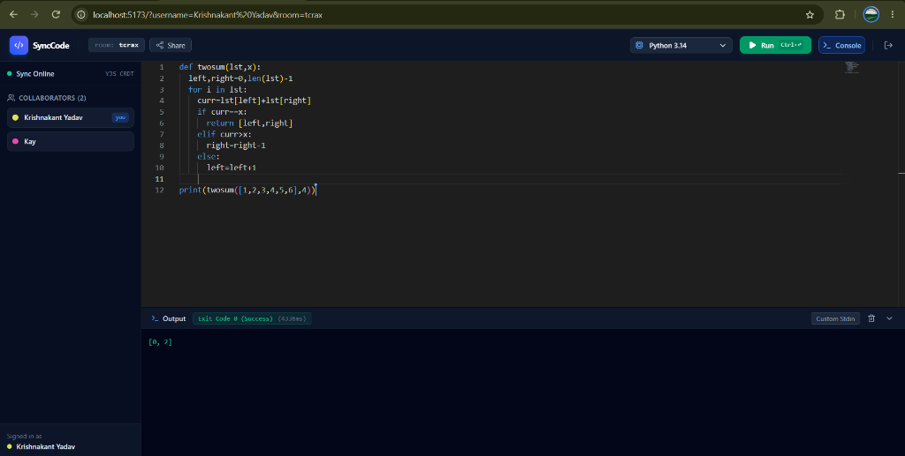
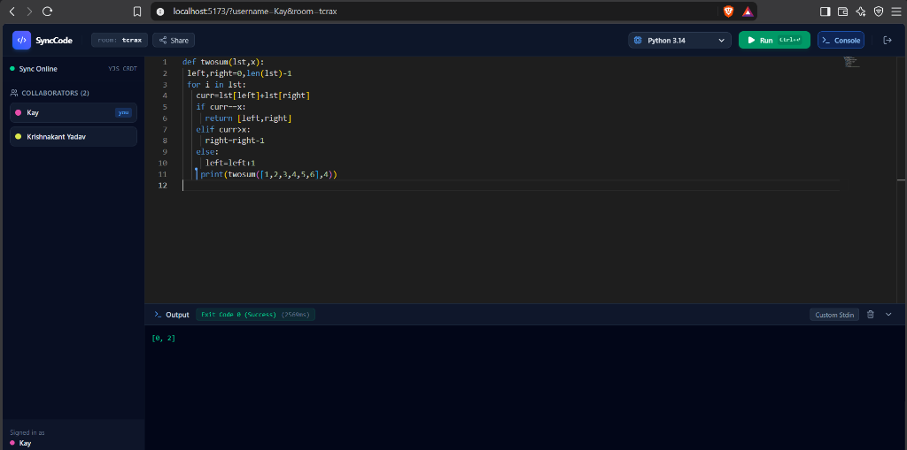
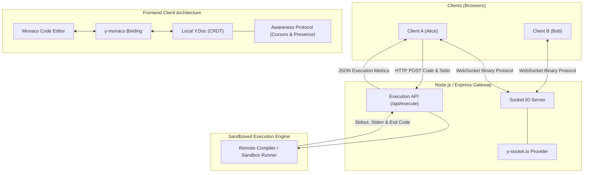

# SyncCode — Real-Time Collaborative IDE & Execution Engine

<p align="center">
  
  
  
  
  
  
</p>

SyncCode is a low-latency, distributed pair-programming environment engineered with **Yjs Conflict-Free Replicated Data Types (CRDTs)**, **Socket.IO WebSockets**, **Monaco Editor**, and a **Sandboxed Remote Code Execution Engine**.

Designed to handle concurrent multi-user editing with mathematical guarantees of eventual consistency, eliminating race conditions and edit collisions without centralized document locking.

---

## Live Multi-User Pair Programming Demo

Two concurrent users editing and executing code in the same isolated room (`room: tcrax`) with real-time awareness and synchronized compiler outputs:

| Client A (`Krishnakant Yadav` in Chrome) | Client B (`Kay` in Brave) |
| :---: | :---: |
|  |  |

---

## Architecture Overview



---

## Key Engineering Features

* **CRDT Concurrency (Yjs)**: Leverages Yjs State Vectors and operation logs to mathematically guarantee eventual consistency across all peers. Concurrent edits resolve deterministically without a central arbiter.
* **Awareness Protocol & Live Carets**: Tracks ephemeral presence states (mouse focus, caret position, username, assigned color palette) independently from the persistent document state, avoiding history pollution.
* **Remote Sandboxed Code Execution**: Executes source code across 7+ compiled and interpreted languages (Python, JavaScript, TypeScript, C++, Go, Rust, Java) with custom stdin, compiler diagnostics, and execution timing metrics.
* **Real-Time Language Synchronization**: Synchronizes active compiler modes and syntax targets across connected clients using shared CRDT meta-structures (`ydoc.getMap('meta')`).
* **Instant Session Onboarding**: Shareable peer-to-peer room URLs (`?room=session-id`) with clipboard integration and clean unmount teardowns.

---

## Why CRDTs over Operational Transformation (OT)?

| Criterion | Operational Transformation (OT) | Conflict-Free Replicated Data Types (CRDTs) |
| :--- | :--- | :--- |
| **Architectural Model** | Centralized server required to serialize & transform operations | Decentralized / peer-to-peer capable; commutative operations |
| **Complexity** | Exponential state combinations for concurrent transforms (`O(n²)`) | Handled mathematically via unique item IDs and relative positioning |
| **Offline Resilience** | Fragile during network partitions; complex re-basing | Seamless local-first buffering and automatic state-vector diff merge |
| **Scalability** | Server acts as a throughput bottleneck | Server acts merely as a lightweight binary relay |

---

## Project Structure

```
collaborativeeditor/
├── assets/                  # Live demo screenshots and architecture assets
│   ├── preview-client-a.png
│   └── preview-client-b.png
├── backend/
│   ├── server.js            # Express, Socket.IO, YSocketIO gateway, code execution proxy
│   └── package.json
└── frontend/
    ├── src/
    │   ├── app/
    │   │   ├── App.jsx      # Workspace UI, Monaco editor, Yjs provider & execution terminal
    │   │   └── App.css      # Remote cursor decoration CSS and custom scrollbars
    │   └── main.jsx
    ├── index.html
    ├── vite.config.js
    └── package.json
```

---

## Getting Started

### Prerequisites
* Node.js 18+ (tested on Node 20 & 24)
* npm or pnpm

### 1. Start Backend Server
```bash
cd backend
npm install
npm start
# Server listens on http://localhost:3000
```

### 2. Start Frontend Dev Server
```bash
cd frontend
npm install
npm run dev
# Frontend runs on http://localhost:5173
```

Open multiple browser tabs or incognito windows with the same `room` parameter (e.g. `?room=tcrax`) to test multi-user real-time typing and execution!
